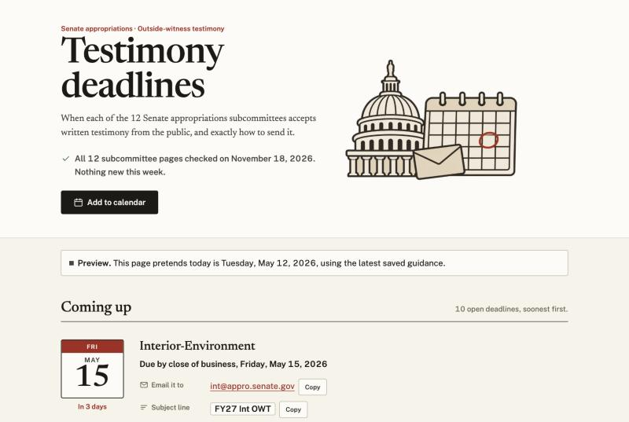

# approps-deadlines

A weekly crawler that watches the **outside-witness testimony guidelines** for all 12 Senate
Appropriations subcommittees. It reports which ones changed and turns each guidelines PDF into a
tracker row you can paste into a Google Sheet.

Each run also rebuilds **a simple web page for congressional staff**: what testimony is due soon and
exactly how to send it, with copy buttons and an "Add to calendar" file. No spreadsheet needed.



This is the first piece of [Congressional Tech proposal IV.3, the Appropriations Notices & Deadlines
Tracker](https://civictechdc.github.io/congressional-tech/proposals/IV.3/). That proposal was the top
priority from the June 2026 meeting with the American Governance Institute (AGI), which keeps this
tracker by hand today.

## What it does

For each Senate subcommittee page (for example
[Legislative Branch](https://www.appropriations.senate.gov/subcommittees/legislative-branch)):

1. **Find the link.** Finds the "Submit Written Testimony" link inside the page's testimony section.
2. **Follow it to the PDF.** Follows the link to the guidelines PDF. Most links go through an
   intermediate `/download/...` page that forwards with a `Refresh` header, then a redirect.
   Defense links straight to the PDF.
   ```
   subcommittee page → /download/owt_guidelines_… → …&download=1 → (302) → /imo/media/doc/….pdf
   ```
3. **Fingerprint and compare.** Fingerprints (SHA-256) the testimony section of the page, the link,
   the final PDF address and the PDF itself, then compares them with the last good run:
   - `first check`: nothing to compare with yet.
   - `yes`: one of those four changed. The report says which.
   - `no`: nothing changed.
   - `unknown`: the page or PDF was broken this run.

   The rest of the page (news, hearings, member photos) is ignored, so a new press release doesn't
   count as a change.
4. **Report broken pages, don't stop on them.** These count as broken: the page is down, a request
   times out, the link is missing, the intermediate page leads nowhere, HTML comes back where a PDF
   should be, or the PDF can't be read. A broken page never overwrites the last good fingerprint, so
   a page that is down one week and back unchanged the next reads `no`, not a false `yes`.
5. **Read the PDF into tracker columns.** Fills in fiscal year, deadline, format, page limit,
   delivery address and subject line with plain text rules (no AI, no API key). When a rule isn't
   sure, the field is left **blank and listed under "Needs review"** instead of guessed.

It is polite to the Senate's servers: one request at a time, a 3-second pause before every request
(redirect hops included), a clear User-Agent, one retry after 15 seconds if a request times out or
the server errors, and a 25 MB size cap. A full run is about 46 requests and takes 2–3 minutes.

## Run it

You need [uv](https://docs.astral.sh/uv/getting-started/installation/). It installs Python and the
two dependencies (`requests`, `pypdf`) for you.

```bash
cd approps-deadlines
uv run approps-deadlines
```

Other options:

```bash
uv run approps-deadlines --list                      # subcommittee ids
uv run approps-deadlines --only senate-defense       # check just one (or a few)
uv run approps-deadlines --delay 5                   # slower: 5 seconds between requests
uv run approps-deadlines --verbose                   # print every request
uv run approps-deadlines --page-only                 # rebuild the web page from saved data, no crawling
uv run approps-deadlines --as-of 2026-05-12          # preview the page as if it were that date (writes preview/)
uv run pytest                                        # run the tests (no network)
```

Open `output/index.html` in any browser to see the page. Out of season (like right now, when every
FY2027 deadline has passed) it says nothing is open. To show what staff will see during the cycle,
use `--as-of` with a spring date and open `preview/index.html`.

No API keys are needed. If you add one later (for example, for AI parsing), put it in a `.env` file.
`.env` is already listed in `.gitignore`.

## What you get

| File | What it is | In git? |
|---|---|---|
| `output/index.html` | The page for staff: coming deadlines, how to send, the cycle at a glance, all 12 subcommittees, what changed. One file with the illustrations built in (fonts load from Google Fonts, with system fonts as the fallback offline) | yes |
| `output/deadlines.ics` | Every deadline that's still open as a calendar event with a one-week reminder (Outlook, Google, Apple) | yes |
| `output/tracker.csv` | One row per subcommittee, with the tracker's nine columns first, ready for Google Sheets | yes |
| `data/reports/latest.md` | This run's report: updated yes/no, broken pages, rows needing review | yes |
| `data/reports/<date_time>.md` | Every past report, by date and time | yes |
| `data/history.csv` | One row per subcommittee per run, only ever appended to | yes |
| `data/state.json` | Last good fingerprints and fields, used for the next comparison | yes |
| `data/text/<id>.txt` | Text of each PDF, so `git diff` shows exactly what changed | yes |
| `downloads/<id>.pdf` | The PDFs themselves | no (git-ignored) |

**CSV columns:** Subcommittee, Fiscal year, Deadline, Format, Page limit, Delivery address,
Subject line, Source URL (the PDF), Last changed (the date the crawler first saw the current
version), then the extras: Chamber, Updated this run, Status, Problem, Needs review, Notes,
Deadline text (the sentence the deadline came from, for checking), PDF last modified (server),
Page URL, Checked at.

**Into a Google Sheet:** open `output/tracker.csv`, copy everything and paste into cell A1, or use
*File → Import → Upload → Replace current sheet*. Once the repo is on GitHub, a sheet can pull it
in automatically with `=IMPORTDATA("https://raw.githubusercontent.com/<owner>/<repo>/main/output/tracker.csv")`.

## Sample output

A real second run on 2026-11-18. The first run said `first check` for all 12; this one confirms
nothing changed in between. The report is printed and saved to `data/reports/`:

```
# Appropriations testimony guidelines check, 2026-11-18 19:30 EST

Checked 12 subcommittee page(s): 0 updated, 12 unchanged, 0 first check, 0 broken. 46 requests.

| Subcommittee | Updated? | Status | Deadline | What changed / problem |
|---|---|---|---|---|
| Senate Agriculture, Rural Development, Food and Drug Administration, and Related Agencies | no | ok | 2026-05-20 |  |
| Senate Commerce, Justice, Science, and Related Agencies | no | ok | 2026-05-22 |  |
| Senate Defense | no | ok | 2026-06-18 |  |
| ...
| Senate Transportation, Housing and Urban Development, and Related Agencies | no | ok | — |  |

## Broken pages (0)

None.

## Needs a human look (3)

- **Agriculture, Rural Development, Food and Drug Administration, and Related Agencies**: format: not found in PDF
- **Military Construction, Veterans Affairs, and Related Agencies**: delivery address: not found in PDF; subject line: not found in PDF
- **Transportation, Housing and Urban Development, and Related Agencies**: deadline: not a fixed date, see deadline text
```

The three flags are real gaps in the PDFs, not crawler errors:

- **Agriculture:** the PDF never says which file format it accepts.
- **MilCon-VA:** only takes testimony through a Committee member's office, so there's no email or
  subject line.
- **THUD:** testimony is due "seven days after the respective Departmental budget hearing".

A broken page looks like this. This is a live test (trimmed) against a made-up address on the real
site and a host that doesn't exist. The healthy page in the same run still went through, and the
command exited normally:

```
## Broken pages (2)

- **Made-up subcommittee (real site, page doesn't exist)**: subcommittee page: HTTP 410 Gone (https://www.appropriations.senate.gov/subcommittees/no-such-subcommittee)
- **Made-up host that can't resolve**: subcommittee page: could not connect (https://approps-deadlines-test.invalid/subcommittees/x)
```

The tracker's columns in `output/tracker.csv` (extra columns left out):

| Subcommittee | Fiscal year | Deadline | Format | Page limit | Delivery address | Subject line | Source URL | Last changed |
|---|---|---|---|---|---|---|---|---|
| Legislative Branch | FY2027 | 2026-05-15 | Word or WordPerfect (no PDF) | 4 | legislativebranch@appro.senate.gov | FY27 LegisBranch OWT | …/owt_guidelines_leg_branch_fy_27.pdf | 2026-11-18 |
| Financial Services and General Government | FY2027 | 2026-05-29 | Word (no PDF) | 4 | finsec@appro.senate.gov | FY27 FSGG OWT | …/owt_guidelines_fsgg_fy27.pdf | 2026-11-18 |
| Transportation, Housing and Urban Development, and Related Agencies | FY2027 | *(blank, see Deadline text)* | Word or WordPerfect (no PDF) | 4 | thud@appro.senate.gov | FY27 THUD Outside Witness Testimony – [Department] | …/owt_guidelines_thud_fy27.pdf | 2026-11-18 |

"Last changed" is the date the crawler first saw the current version. "PDF last modified (server)"
shows when the Senate posted it (2026-04-21 for most).

## Weekly schedule

**GitHub Actions (recommended).**
[`.github/workflows/weekly-crawl.yml`](.github/workflows/weekly-crawl.yml) runs every Monday at
14:17 UTC (9:17 a.m. Eastern in winter), and you can also start it from the Actions tab with
*Run workflow*. Each run:

1. Runs the tests.
2. Crawls the 12 pages.
3. Posts the report on the run's summary page.
4. Commits the new history, reports and CSV back to the repo.

That commit is how the dated history is kept.

> The workflow hasn't run yet: it starts working once this repo is pushed to GitHub. Under
> *Settings → Actions → General → Workflow permissions*, allow "Read and write permissions" so it
> can commit.

**Or cron, on any always-on machine:**

```cron
17 9 * * 1  cd /path/to/approps-deadlines && /opt/homebrew/bin/uv run approps-deadlines >> cron.log 2>&1
```

Use the output of `which uv` for the uv path. `cron.log` is git-ignored. With cron, the history stays
on that machine unless you commit and push it yourself.

## The page for staff

It is built for people who aren't technical and don't have time:

- **Coming up.** Each open deadline appears as a large date with a countdown ("In 3 days"). Under it,
  in plain words: who to email (one click opens an email with the subject line filled in), the exact
  subject line, the file format and the page limit. Copy buttons sit next to the email address and
  subject line.
- **Rows that need a human.** These say so ("Please check: the PDF doesn't say which file format to
  send"). MilCon-VA's member-office rule and THUD's rolling deadline are spelled out in plain
  language.
- **Warnings at the top.** A banner appears when a subcommittee posts new guidance, and another when
  a page couldn't be reached that week.
- **The rest of the page.** The cycle at a glance (a timeline on wide screens, a list on phones), all
  12 subcommittees, and a plain log of every weekly check.
- **For tracker keepers.** The calendar button downloads every deadline that's still open (it's hidden when nothing is open). The footer links to the full
  table as a spreadsheet for people like AGI who keep their own tracker.

Built to be accessible and to work on a phone:

- **Accessible.** Colors picked for WCAG AA contrast in light and dark mode (not yet formally audited), a visible keyboard focus ring, a "skip
  to deadlines" link, 44 px tap targets on touch screens, and no animation.
- **Tested at phone widths.** Checked at 320 and 375 px with no sideways scrolling.
- **Fonts.** Public Sans (the U.S. government's typeface) for text, and Newsreader for headings.
- **Illustrations.** The two illustrations were generated with an AI image model (OpenAI's, through
  the Codex CLI) and live in `src/approps_deadlines/assets/`.

## What it doesn't do yet

- **The page isn't hosted yet.** It's a file in `output/`. Putting it on GitHub Pages, so staff get a
  link, is a small next step once the repo is on GitHub.
- **Senate only.** The House subcommittee pages aren't covered yet.
- **Text rules only.** Rules written from the 12 FY2027 Senate PDFs. A PDF in a new style may come
  back with blank fields flagged "Needs review" until someone adds a rule or AI parsing.
- **One deadline per subcommittee.** It reads only the deadline for written testimony: no separate
  dates for requests to testify in person, Member office requests, or hearing dates (the proposal
  lists all of these). When it finds several dates it flags the row rather than picking one.
- **No hearing announcements.** It reads only the testimony section of each page, not the hearings
  tab.
- **No automatic Sheet or alerts.** It doesn't push to a Google Sheet or send alerts. The CSV is
  pasted by hand (or pulled with `IMPORTDATA`), and a `yes` shows up only in the report.
- **No BillTrax calendar yet.**
- **Hardcoded page list.** If the Senate renames a page, that page shows as broken (the Senate site answers "410 Gone") until
  someone updates [`sources.py`](src/approps_deadlines/sources.py).
- **Unchecked against AGI.** The rows haven't been compared with AGI's hand-kept tracker yet.

Right now every row is FY2027 guidance (posted April 2026, deadlines April–June 2026). The FY2028
guidance will probably appear next spring, and that's when the `yes` reports will matter.

## How the code is laid out

```
src/approps_deadlines/
  sources.py   the 12 Senate subcommittee pages
  fetch.py     polite HTTP: pauses, manual redirects, retry, size cap
  crawl.py     page → testimony link → intermediate page(s) → PDF → text
  extract.py   text rules: fiscal year, deadline, format, page limit, address, subject
  tracker.py   fingerprints, change detection, history, CSV and report
  site.py      the staff page (output/index.html), built from saved results
  ics.py       the calendar file (output/deadlines.ics)
  assets/      the page's two illustrations
  cli.py       the `approps-deadlines` command
tests/         fake-website tests for every broken-page case, and the text rules
               against all 12 real FY2027 PDFs (text in tests/fixtures)
```
